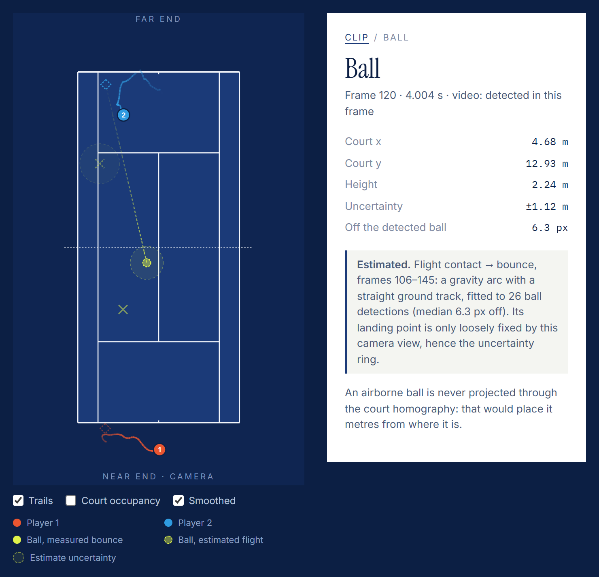
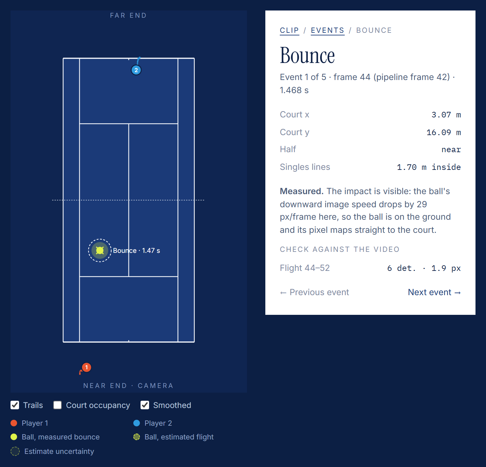
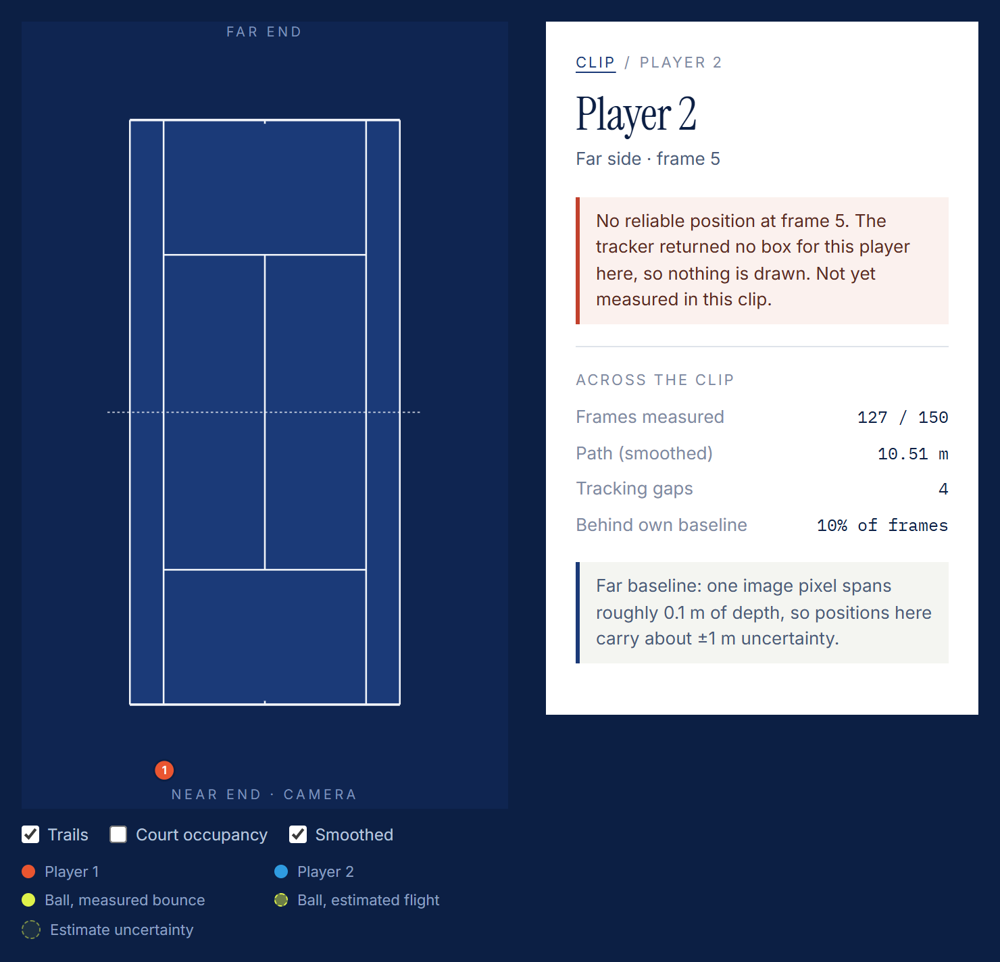
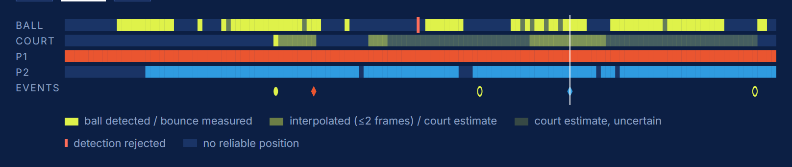
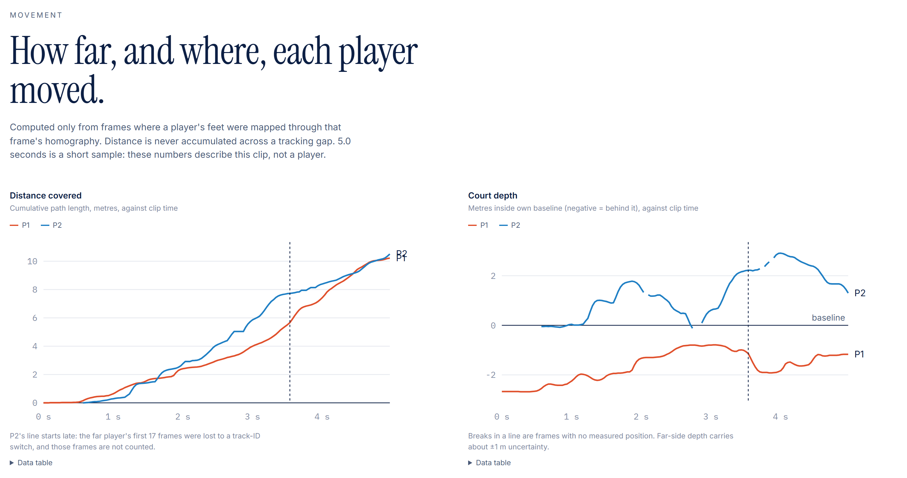
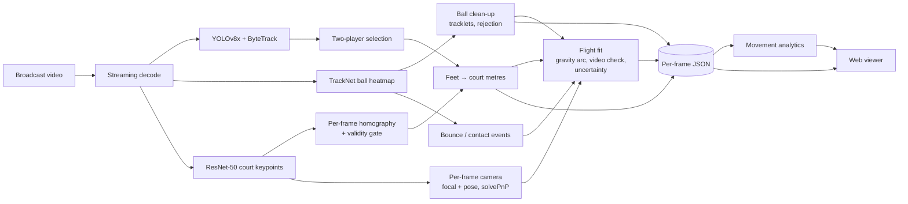

# Tennis Vision

Tennis analysis from a single broadcast camera: player tracking, ball tracking, court
calibration and an estimated ball flight on a top-down court. The web viewer keeps the
video, the court and the analysis panel in frame-exact sync.

<p align="center">
  
</p>

## The problem

From one broadcast camera, a court position needs three things to go right on every
frame:

- finding the two players among a dozen people;
- finding a small, often blurred ball;
- knowing where the court is while the camera pans.

The usual shortcut fails on the ball. A court homography maps the **ground plane**, and an
airborne ball is not on it, so projecting the ball's pixel puts it metres from where it
is. That is the "teleporting ball" in many tennis demos.

This project places the ball on the court only where the geometry supports it. Bounces the
video shows are measured. Flights between events are estimated: a gravity-constrained arc
fitted to the detected ball through a calibrated camera, drawn with its uncertainty, and
only where it agrees with the video.

## Features

- **Frame-synchronised viewer.** The court is drawn for the frame the video is presenting
  (`requestVideoFrameCallback`), with no separate timer. Play, pause, seek, frame step and
  speed changes cannot drift.
- **Ball on the video.** Real detections with a short trail. Interpolation is limited to
  gaps of ≤ 2 frames, and rejected false positives are marked as rejected.
- **Ball on the court.** A solid marker for measured bounces. Translucent dashed markers,
  trails and uncertainty rings for estimated flight. Nothing is drawn where the model is
  not supported.
- **Players.** Markers and trails (broken at tracking gaps), plus a court-occupancy layer.
- **Detection-quality timeline.** Per-frame rows for the video ball, the court ball, P1,
  P2 and the events. Click or drag to seek.
- **Context panel.** Changes with the selection: a clip overview, a player, the ball, or a
  bounce or contact. It always says whether a value is measured or estimated, and why
  something is missing.
- **Movement analytics.** Distance covered, court depth over time and a per-player table.
  Charts are synced to the video, and clicking one seeks it.

| | |
|---|---|
|  |  |
| A measured bounce: the impact is visible in the video. | No detection: nothing is drawn, and the panel says why. |





*The screenshots leave out the broadcast video on purpose: the footage is third-party and
is not redistributed. Run the viewer locally to see it with the video (see
[Run the website](#run-the-website)).*

## Tech stack

- **Python:** PyTorch, Ultralytics YOLOv8x + ByteTrack, TrackNet, a ResNet-50 keypoint
  regressor, OpenCV (homography, `solvePnP`), SciPy (least squares), PyAV.
- **Web:** plain HTML, CSS and JavaScript with no build step; SVG court, Canvas overlay and
  timeline.
- **Tests:** pytest, and headless Chrome driven over the DevTools protocol.

## Architecture



### Player tracking

YOLOv8x detects people and ByteTrack links them over time; the tracker is set explicitly,
because newer Ultralytics releases default to a tracker that drops the small far player.
The two players are chosen once for the whole clip by court position, size and
persistence, and must stand on opposite sides of the net. A player's position is their
feet (bottom-centre of the box) mapped through that frame's homography. A frame without a
tracked box has no position.

### Ball tracking

TrackNet gives at most one ball position per frame.
[`analytics/ball_track.py`](analytics/ball_track.py) cleans that up before anything is
shown:

- detections are linked into tracklets under a speed bound;
- an isolated, unconfirmed detection is rejected;
- gaps are filled only inside a tracklet, across at most 2 missing frames, and never
  across a bounce or contact.

Retained detections are not smoothed, so real changes of direction stay sharp.

### Court detection, homography and camera

A ResNet-50 regresses 14 court keypoints on every frame, so camera pans are followed. The
keypoints give a per-frame homography for the ground plane. A validity gate checks that the
predicted lines lie on painted pixels before any position is trusted.

[`analytics/ball_flight.py`](analytics/ball_flight.py) also recovers a full pinhole camera
per frame: one focal length for the clip, chosen by minimising keypoint reprojection, and
the pose from `cv2.solvePnP`. On the demo clip the keypoints reproject to within 0.43 px
(median), the projected net tape lies on the real one, and a 1.88 m vertical at each
player's feet matches their box height.

### Estimated ball flight

- **Bounces.** A bounce is **measured** only where the video shows the impact (a sharp drop
  in the ball's downward image speed); its pixel then maps to the court directly. A bounce
  the camera missed is a free parameter, searched only inside the detection gap.
- **Contacts.** At a contact, the strike height is fitted, and the ball must be within
  reach (≤ 1.5 m) of the hitter's measured position.
- **Flights.** Between events the ball follows a gravity arc over a straight ground track,
  with an optional drag-like slow-down. All unknowns are fitted jointly (SciPy least
  squares) to the detected ball pixels, through each frame's camera.
- **Acceptance.** A flight is shown only if it matches the video (median error ≤ 10 px).
  Frames where the nearest detection disagrees by more than 25 px are hidden.
- **Uncertainty.** This is the spread of the positions given by equally good fits. It is
  large where the ball travels along the camera's line of sight, where height and depth
  cannot be separated from one view.

Demo clip, first 150 frames:

| Flight | Median error vs detections | Ground-position uncertainty |
|---|---|---|
| bounce (measured) → P1 contact | 1.9 px | ±0.3 m |
| P1 contact → bounce (unseen) | 3.7 px | up to ±1.35 m |
| bounce (unseen) → P2 contact | 2.6 px | up to ±1.35 m |
| P2 contact → bounce (unseen) | 6.3 px | up to ±2.6 m |

91 of 150 frames have a court estimate. The serve has no detected contact, so it is not
modelled.

## Analytics

[`analytics/movement.py`](analytics/movement.py) works from measured player positions
only.

- **Distance.** Path length summed over consecutive measured frames; never across a
  tracking gap.
- **Depth.** Metres inside the player's own baseline; negative means behind it.
- **Occupancy.** The share of measured frames per 1 m² cell.

At the far baseline one image pixel spans about 0.1 m of depth, so far-player positions
carry roughly ±1 m of uncertainty. Shot speeds, winners and rally outcomes are not
computed.

## Installation

```bash
git clone <this repository> && cd Tennis-Vision
python -m venv venv
venv\Scripts\activate                 # macOS/Linux: source venv/bin/activate
pip install -e .
python scripts/download_models.py     # court keypoint and pose models
gdown 1XEYZ4myUN7QT-NeBYJI0xteLsvs-ZAOl -O models/tracknet.pt   # TrackNet, from its author
```

YOLOv8x downloads itself on first use. Model weights and videos are gitignored.

## Run the website

```bash
python web/serve.py                   # http://localhost:8000
```

`web/data/demo_frames.json` (positions only) is in the repository. The video clip and
stills in `web/media/` are not, because they are broadcast footage. Without them the
viewer opens in a frame-stepping mode with the court, timeline and panel fully working.
To regenerate them, put the source clip in `input_videos/` and run step 2 below.

## Run the analysis pipeline

```bash
# 1. Per-frame detection export. Streams one frame at a time (about 1.3 GB RAM),
#    checkpoints every 25 frames and resumes automatically.
python scripts/export_web_data.py --input input_videos/tennis_clip.mp4 \
    --end-frame 2335 --out-dir output/web_data

# 2. Package for the viewer: frame-exact clip cut, ball clean-up, flight fit, analytics.
python scripts/prepare_web_demo.py --frames-json output/web_data/tennis_clip_frames.json \
    --video input_videos/tennis_clip.mp4 --out web
```

`--end-frame` is exclusive. Choose it so the segment is one continuous camera take (no
cuts or replays).

## Colab GPU notebook

Detection is slow on a CPU: 150 frames took 29 minutes on the development laptop.
[`notebooks/colab_gpu_export.ipynb`](notebooks/colab_gpu_export.ipynb) runs step 1 on a
Colab GPU:

1. Set the runtime to GPU, and set `REPO_URL` in the notebook to your copy of this
   repository.
2. Put the video in `MyDrive/tennis_vision/input_videos/`.
3. Run the cells.

The notebook caches the weights, keeps checkpoints and outputs on Google Drive, benchmarks
40 frames, fails if CUDA is not in use, validates the export and packages it for the
viewer. It has not yet been run end to end on a GPU.

## Testing

- **Python:** **426 unit and integration tests** (`pytest tests/`): 412 upstream, plus 14
  for the ball clean-up, flight fit and movement analytics. The flight tests recover a
  synthetic rally through a synthetic camera within the reported uncertainty, and check
  that a contradicted flight is withheld. `pytest tests/ -m "not slow"` needs no model
  weights.
- **Browser:** `node tests/web/web_test.mjs`, with `web/serve.py` running. It makes 28
  checks in headless Chrome using real mouse and keyboard input, including:
  - the court frame equals the frame on screen during playback;
  - player and ball markers equal their JSON positions;
  - the ball appears on the court exactly where a flight estimate exists;
  - the measured bounce renders solid;
  - frames the video contradicts show no court ball;
  - seeking, frame stepping and every selection type;
  - the mobile layout;
  - no console errors.
- **Exporter:** after a forced kill and resume, the ball and court outputs are
  bit-identical to an uninterrupted run.

Screenshots are produced by `node scripts/capture_screenshots.mjs`, which captures no
footage.

## Known limitations

- **Short sample.** Only the first 5 seconds of the clip have been analysed. The full
  78-second court segment needs the GPU notebook.
- **Single view.** Ball height and depth are poorly separated when the ball travels along
  the camera's line of sight. The uncertainty rings show this; they do not remove it.
- **Missed events.** Event detection misses contacts and bounces (the upstream author
  measured about 72% contact recall). A flight is modelled only between two detected
  events, so the serve here is not modelled.
- **Track fragmentation.** A player's ByteTrack ID can switch. Selection keeps one ID per
  player, so the frames under the other ID are lost (17 frames for P2 in the demo).
- **Camera cuts and frame rate.** Clips with camera cuts must be trimmed. Frame-rate
  support is 23–31 fps.

## Future improvements

- Stitch player tracklets within a court half.
- Use audio onsets to recover missed contacts, so the serve can be modelled.
- Add spin (Magnus) and a proper drag model to the flight fit.
- Process the full clip on a GPU.

## Credits

Built on [Tennis-Vision by HarshTomar1234](https://github.com/HarshTomar1234/Tennis-Vision)
(MIT), which supplies the detection, tracking, court model and event pipeline. Its
original README and evaluation record are in
[docs/public/UPSTREAM_README.md](docs/public/UPSTREAM_README.md).

Third-party models:
- TrackNet weights: [yastrebksv/TrackNet](https://github.com/yastrebksv/TrackNet),
  research use, not redistributed.
- Player detection: [Ultralytics YOLOv8](https://github.com/ultralytics/ultralytics),
  AGPL-3.0.

Licensed under MIT; see [LICENSE](LICENSE).
